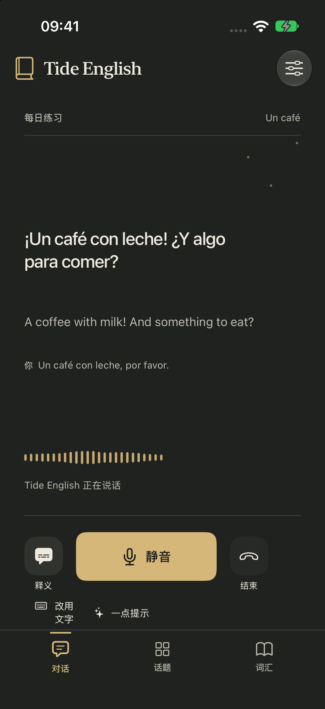
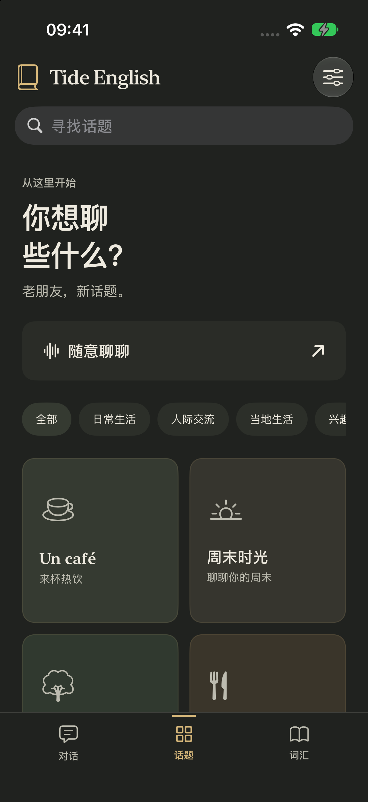
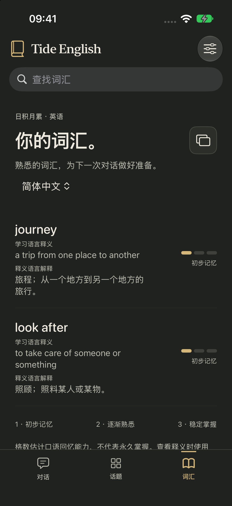
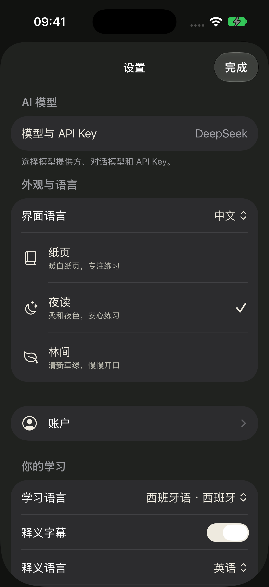

# Tide English

[English](README.md) | **简体中文**

原生语言学习应用，通过自然对话练习表达、理解和词汇。包含 SwiftUI iOS 客户端、Jetpack Compose 安卓客户端，以及独立邮箱账户服务。

Tide English 默认使用你自己的模型 API Key。学习记录保存在设备上，注册登录为可选功能；托管语音、试用和购买默认关闭。仓库包含完整源码和锁定依赖，不包含用户密钥、个人签名或历史构建产物。

## 应用截图

<p align="center">
  <a href="docs/assets/screenshots/ios/zh-CN/talk.png"></a>
  <a href="docs/assets/screenshots/ios/zh-CN/themes.png"></a>
  <a href="docs/assets/screenshots/ios/zh-CN/vocabulary.png"></a>
  <a href="docs/assets/screenshots/ios/zh-CN/settings.png"></a>
</p>
<p align="center">对话 · 主题 · 双语词汇 · 设置</p>

使用当前 iOS 应用在 iPhone 17 模拟器中实拍，展示中文界面与 Midnight 深色主题。内容来自离线示例，不含真实对话、API Key 或个人学习记录。[英文界面](README.md#screenshots) · [截图说明](docs/assets/screenshots/README.md)。

## 功能

| 功能 | 说明 |
| --- | --- |
| 多模型 | OpenAI、DeepSeek、GLM、Gemini 和自定义兼容接口；统一设置入口管理模型、地址与密钥 |
| 语音 | 支持原生实时语音；其他模型降级为设备识别、所选模型生成和系统朗读，设备不支持时保留打字 |
| 双语学习 | 独立学习语言和释义语言，双语字幕、词语查询、词汇释义和复习 |
| 个性化教学 | 对话纠错、主题、学习目标与能力证据，各语言独立记录 |
| 外观 | Paper、Midnight、Grove 主题；中文或英文界面，独立于学习语言 |
| 本地数据 | 对话、词汇、学习进度，支持手动备份与导入 |
| 可选账户 | 邮箱验证码登录、退出和删除；不启用学习云同步 |

实时音频模型受服务商能力限制，可能与设置中的文本模型不同。Android 设备语音需要 Android 12+ 可用本地识别与离线朗读语音；否则使用文字。Gemini 实时连接到期后需重连。模拟器测试不能证明真机麦克风、蓝牙或某个账户的模型访问权限。

## 目录结构

```text
tide-english/
├── mobile/
│   ├── ios/                 # SwiftUI、Swift 核心包、Xcode 工程与测试
│   │   ├── Application/
│   │   ├── Domain/
│   │   ├── Configuration/
│   │   └── TideEnglish.xcodeproj/
│   └── android/             # Compose、Kotlin 核心与 Gradle 工程
├── server/
│   ├── accounts/            # 邮箱验证码与账户服务
│   └── gateway/             # 默认不启用的可选托管网关
├── packages/
│   ├── contracts/           # 跨端协议
│   └── fixtures/            # 共享回归样例
├── tools/                   # 工程生成、内容导出与一致性检查
├── distribution/            # 发行模板和示例目录数据
└── docs/                    # 使用、开发、架构和运维指南
```

## 让 AI Agent 帮你安装到手机

先用 Agent 打开或附加这个工程目录，再把下面整段提示词发给它。两份 README 的 Agent 提示词统一使用英文，内容完全一致。提示词同时适用于 iPhone 和安卓；Agent 需要具备本机文件、终端和设备访问能力。Apple Account 登录、系统密码、手机信任和权限确认仍由你在系统界面完成，无需把任何密钥或密码发到聊天中。

```text
Help me build, install and launch Tide English on my connected iPhone or
Android phone.

Use this checkout if it is already open, or clone the Tide English repository
URL I provide into a new local folder. If neither is accessible, ask for the
actual source location; do not invent a repository URL. Read AGENTS.md,
README.md or README-CN.md, docs/development/build-and-test.md, and the matching
platform guide: docs/guides/iphone.md or docs/guides/android.md. Preserve local
changes and use pinned dependencies without upgrading them.

Detect my connected physical phone and explicitly target that device. If
multiple phones make the target unclear, ask me to choose before installing.
Do not substitute a simulator or emulator for installation on my phone.

For iPhone, check that macOS, Xcode and its iOS tools are ready, resolve the
pinned packages, run the offline Swift core tests, and build the iOS Simulator
target. Use mobile/ios/TideEnglish.xcodeproj and the TideEnglish scheme.
Guide me through adding my Apple Account and choosing my signing team in
Xcode when needed. Preserve signing overrides in the ignored
mobile/ios/Configuration/Local.xcconfig before regenerating the project.
Build for my iPhone with the configured team, then install and launch it.

For Android, check JDK 17, Android SDK Platform 36, Build Tools 35.0.0 and adb.
Use the Gradle Wrapper in mobile/android to resolve dependencies and run
:app:testDebugUnitTest, :app:lintDebug and :app:assembleDebug. Check the APK's
identity and signing certificate, install with adb -s TARGET_SERIAL install -r,
and launch the app on that same phone.

For a first installation, help me choose a unique application identifier if
needed. When updating an existing installation, preserve its identifier and
signing identity, including the Apple team on iPhone. Do not uninstall, clear
learning data, force a downgrade or silently change identifiers to bypass a
conflict. Retain any same-name app with a different identifier as a separate
installation. If signing cannot be matched, preserve the app and explain why.

Proceed with the normal checks, builds and installation within your permission
rules. Tell me when I need to connect or unlock the phone, trust this computer
or developer profile, enable Developer Mode or USB debugging, select a team,
or approve a system prompt. I will enter passwords and verification codes in
the system UI; never ask me to send them in chat.

I will choose my learning, explanation and interface languages, then select a
provider and enter my own API key in Settings > Model & API key. Do not ask me
to paste the key into chat, read model keys or account tokens from device
storage, or put credentials in source files or logs. Keep managed/hosted
services, trials, purchases and learning cloud sync disabled. Email sign-in
must remain optional. Do not deploy servers, modify production data, send
verification emails or make live model requests during installation.

Finish by reporting the target phone, application identifier and version,
which test, build, signing, installation and launch checks passed, artifact
paths, iOS signing expiry if available, and anything I still need to do on the
phone. Report blockers accurately; a successful build alone is not a completed
installation. I will start the first live conversation.
```

## 本地运行

### iOS

准备支持 iOS 26.1 SDK 的 Xcode。纯 Swift 核心测试需要 Swift 6 工具链。在根目录执行：

```sh
python3 tools/generate_project.py
open mobile/ios/TideEnglish.xcodeproj
```

在 Xcode 添加 Apple Account，选择自己的签名 Team。默认 bundle identifier 为 `cn.gd306.tideenglish.ios`；如被占用，使用本机签名配置覆盖为自己的唯一标识。详见 [iPhone 指南](docs/guides/iphone.md)。

### Android

准备 JDK 17、Android SDK Platform 36 和 Build Tools 35.0.0，设置 `JAVA_HOME` 和 `ANDROID_HOME`：

```sh
cd mobile/android
./gradlew :app:assembleDebug
```

APK 输出到 `mobile/android/app/build/outputs/apk/debug/app-debug.apk`，应用标识为 `cn.gd306.tideenglish.android`。详见 [安卓指南](docs/guides/android.md)。

### 模型与账户

进入应用选择学习和释义语言，在 **设置 → 模型与 API 密钥** 填入自己的密钥。不要把密钥写进源码、日志或聊天。不同服务商与自定义地址分别保存凭据；改变发送对象后需要重新确认权限。详见 [模型与语音](docs/guides/models-and-voice.md)。

邮箱为可选组件。客户端沿用 `https://api.gd306.cn` 的邮箱账户合同，本次重建没有部署或修改该线上服务。自建实例见 [账户服务指南](docs/operations/accounts.md)。邮箱账户与托管网关是独立组件。

## 验证与开发

```sh
python3 -m unittest discover -s tools/tests -t .
python3 tools/export_android_content.py --check
python3 tools/check_cross_platform.py
swift test --package-path mobile/ios
```

完整命令见 [构建与测试](docs/development/build-and-test.md)，实际结果和限制见 [验证记录](docs/development/verification.md)。共享教学逻辑需要同步 Swift、Kotlin 与契约检查。

## 独立身份与学习数据

新工程使用独立应用标识，不会自动读取已有安装的沙箱或密钥。本次重建没有卸载应用、清理旧数据或修改线上数据库。需要迁移时，在原应用导出学习备份，再在新应用手动导入；模型密钥重新填写。不要为处理签名不匹配而卸载原应用。

发行模板、示例商品和价格不代表新应用已经上架或可支付。发布前需要自己的签名、商店应用和服务端配置，商业开关维持关闭直至单独验证完成。

官网、支持、隐私及条款链接使用保留的 `.example` 域名作为发行配置示例，尚未部署。对外发布前必须替换为自己实际提供的页面；这些示例地址不会用于模型请求或当前邮箱登录。

## 许可

[MIT License](LICENSE)，保留原始版权及第三方归属。来源见 [NOTICE](NOTICE)，贡献约定见 [CONTRIBUTING.md](CONTRIBUTING.md)，安全处理见 [SECURITY.md](SECURITY.md)。
