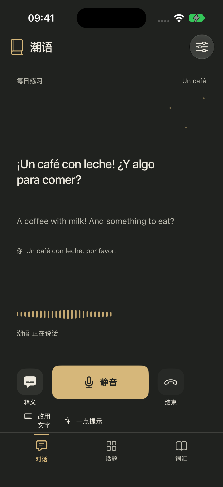
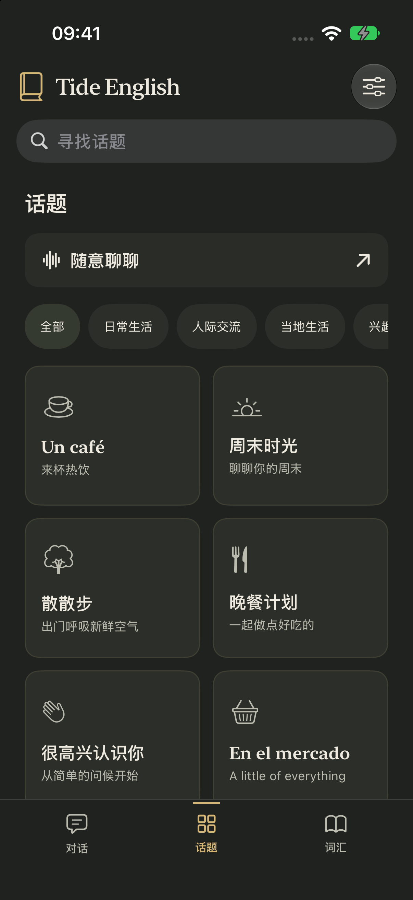
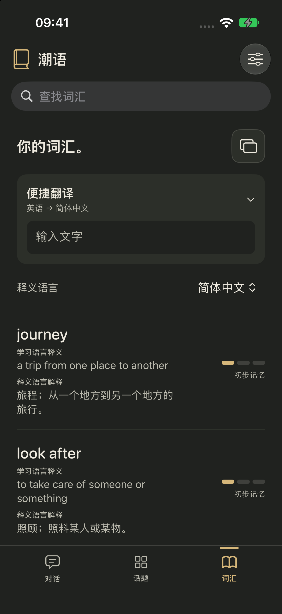
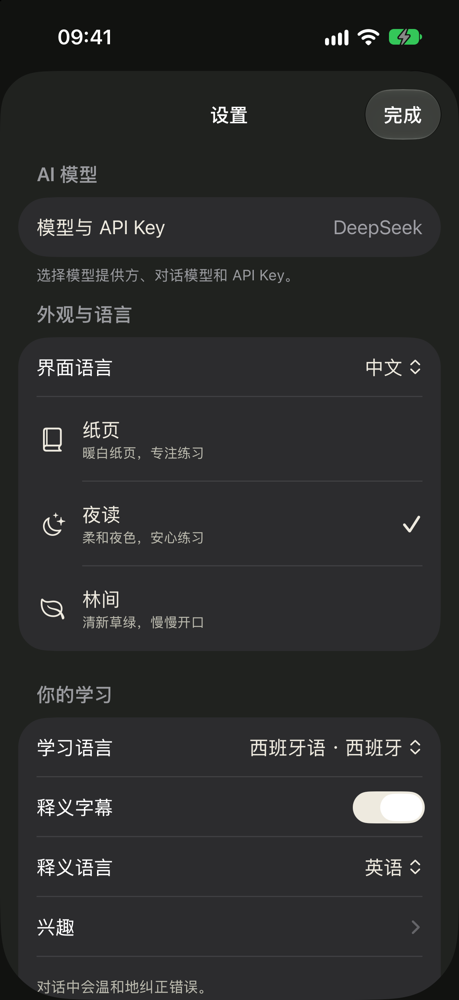

# 潮语 Tide

多语言学习伙伴。

<p align="center">
  <strong>原生多端 AI 语言学习应用，让自然对话成为最好的语言老师。</strong>
</p>

<p align="center">
  <a href="README.md">English</a> | <strong>简体中文</strong>
</p>

<p align="center">
  
  
  
  
</p>

---

潮语 Tide 是一款专为提升外语表达、听力理解与词汇积累而设计的原生跨端语言学习应用。通过与大语言模型进行自然流利的实时对话，提供即时语法纠错、情境生词释义与个性化教学引导。

本项目包含基于 **SwiftUI** 的 iOS 客户端、基于 **Jetpack Compose** 的 Android 客户端，以及一个轻量独立的邮箱账户后端服务。

### 核心设计原则

- 🔑 **自带 Key (BYOK)**：默认直接连接你自己的大模型服务商（OpenAI、DeepSeek、智谱 GLM、Google Gemini 或兼容协议的自定义端点），无任何第三方代理中间商。
- 🔒 **本地优先与隐私保护**：所有对话历史、生词本和学习进度均完整存储于设备本机沙箱内，不设隐式数据上传。
- 🚀 **开箱即用，无需登录**：App 内账户登录、托管语音及内购功能默认完全关闭，填写模型 API Key 即可畅享完整学习功能。
- 📦 **纯粹干净**：开源仓库仅包含完整源码与锁定依赖，不含任何私人密钥、个人签名或历史构建缓存。

---

## 应用截图

<p align="center">
  <a href="docs/assets/screenshots/ios/zh-CN/talk.png"></a>
  <a href="docs/assets/screenshots/ios/zh-CN/themes.png"></a>
  <a href="docs/assets/screenshots/ios/zh-CN/vocabulary.png"></a>
  <a href="docs/assets/screenshots/ios/zh-CN/settings.png"></a>
</p>
<p align="center">
  <sub>从左至右：双语对话 · 丰富主题 · 词汇与即时翻译 · 模型与外观设置（Midnight 深色主题）</sub><br />
  <sub>👉 查看 <a href="README.md#screenshots">英文界面截图</a> · <a href="docs/assets/screenshots/README.md">截图拍摄与复现说明</a></sub>
</p>

---

## 核心特性

- 🎙️ **实时语音与对话练习**
  - **原生超低延迟语音**：支持 OpenAI WebRTC、GLM 与 Gemini WebSocket 原生实时音频对话。
  - **智能语音降级机制**：对于 DeepSeek 等纯文本模型，自动降级为「端侧语音识别 + 文本模型生成 + 系统 TTS 离线朗读」；在设备不支持语音的环境下自动保留文字输入。
- ⚡ **词汇页即时翻译**
  - 词汇列表顶部提供常驻紧凑翻译框，展开时提供语言选择、互换、复制与重试工具，输入停顿后自动翻译（单次最高 2,000 字符）。
  - 纯粹作为辅助查询工具，即查即用，不影响生词掌握度与复习进度统计。
- 🤖 **主流大模型自由切换 (BYOK)**
  - 统一的设置中心，集中管理 OpenAI、DeepSeek、智谱 GLM、Google Gemini 或任何兼容 OpenAI 协议的自定义 Endpoint。
  - 密钥独立隔离加密保存在本地钥匙串/加密存储中，变更请求地址时需重新授权确认。
- 🎯 **自适应双语教学**
  - 学习语言（如西语、日语）与释义母语（如中文、英文）完全独立解耦，支持 11 种语言双语字幕。
  - 交互式轻触查词、语境释义、即时语法纠错、学习目标追踪与能力评级，各语种学习记录互不干扰。
- 🎨 **原生质感与多主题定制**
  - 纯原生 UI 编写（iOS SwiftUI + Android Compose），极致流畅动效。
  - 内置 **Paper（纸张）**、**Midnight（夜间）** 与 **Grove（林荫）** 三款精致主题，支持中/英双语界面。
- 💾 **本地优先与自由备份**
  - 数据 100% 掌握在自己手中。提供完备的 JSON 备份导出与导入恢复功能，方便在设备间自由迁移。

> [!NOTE]
> **兼容性与运行提示**：
> - 实时音频模型受服务商能力限制，可能与设置中的常规文本模型不同。
> - Android 设备语音需要 Android 12+ 且系统安装了本地识别与离线 TTS 引擎；否则自动降级为文字对话。Gemini 实时连接到期后需重新建立连接。
> - 模拟器环境无法完整模拟物理麦克风降噪与蓝牙音频路由，推荐在真实手机上体验语音对话。

---

## 目录结构

```text
tide/
├── mobile/
│   ├── ios/                 # iOS 客户端：SwiftUI、Swift 核心包与 Xcode 工程
│   │   ├── Application/     # 视图、UI 协调器与原生组件
│   │   ├── Domain/          # 核心教学业务逻辑、模型协议与本地存储
│   │   ├── Configuration/   # 编译与本地签名配置模版（Local.xcconfig）
│   │   └── TideEnglish.xcodeproj/
│   └── android/             # Android 客户端：Jetpack Compose、Kotlin 核心与 Gradle 工程
├── server/
│   ├── accounts/            # 独立邮箱验证码与账户服务（默认关闭）
│   └── gateway/             # 可选托管网关服务（默认关闭）
├── packages/
│   ├── contracts/           # 跨端共享的数据与协议规范
│   └── fixtures/            # 跨平台回归测试数据集
├── tools/                   # 工程生成、字典导出及跨平台一致性检查脚本
├── distribution/            # 发布模板与示例配置目录
└── docs/                    # 完整的使用指南、开发架构与运维文档
```

---

## 快速上手与本地运行

### 1. iOS 客户端运行

**环境要求**：支持 iOS 26.1 SDK 的 Xcode，以及 Swift 6 工具链。

在仓库根目录下运行：

```sh
# 1. 生成并同步 Xcode 工程文件
python3 tools/generate_project.py

# 2. 打开 Xcode 工程
open mobile/ios/TideEnglish.xcodeproj
```

- 在 Xcode 中选择 `TideEnglish` Scheme。
- 前往 **Xcode → Settings → Accounts** 登录你的 Apple Account，并在 **Signing & Capabilities** 中选择自己的开发 Team（开启自动签名）。
- 默认 Bundle Identifier 为 `cn.gd306.tideenglish.ios`。若已被占用，可在 `mobile/ios/Configuration/Local.xcconfig`（可从同目录下的 `Local.example.xcconfig` 复制）中覆盖 `PRODUCT_BUNDLE_IDENTIFIER`。
- 连接手机并解锁，开启开发者模式后即可直接运行。详见 [iPhone 详细指南](docs/guides/iphone.md)。

---

### 2. Android 客户端运行

**环境要求**：JDK 17、Android SDK Platform 36、Build Tools 35.0.0，并配置好 `JAVA_HOME` 和 `ANDROID_HOME`。

在命令行中执行：

```sh
cd mobile/android
./gradlew :app:assembleDebug
```

- 编译生成的 APK 文件位于：`mobile/android/app/build/outputs/apk/debug/app-debug.apk`。
- 默认 Application ID 为 `cn.gd306.tideenglish.android`（最低支持 Android 8.0 / API 26）。
- 安装至真机：`adb -s <DEVICE_SERIAL> install -r app/build/outputs/apk/debug/app-debug.apk`。详见 [Android 详细指南](docs/guides/android.md)。

---

### 3. 模型与 API 密钥配置

应用安装启动后，即可开始使用：
1. 首次打开应用，选择你想学习的语言和母语释义语言。
2. 前往 **设置 → 模型与 API 密钥**，选择你的模型服务商（OpenAI / DeepSeek / 智谱 GLM / Google Gemini / 自定义）并填入对应的 API Key。
3. 返回主界面，即可开始对话练习与生词查询。详见 [模型与语音指南](docs/guides/models-and-voice.md)。

> [!IMPORTANT]
> **安全守则**：切勿将真实的 API Key 写进任何代码、配置文件、终端日志或提交至 Git 仓库中。所有密钥均加密保存在设备本机沙箱内。

---

## 让 AI Agent 帮你安装到手机

如果你正在使用具备终端与设备交互能力的 AI 编程助手（如 Antigravity、Claude Code、Cursor 等），可直接将下方提示词发送给 Agent，让其自动完成环境检查、依赖解析、编译打包与真机部署：

<details>
<summary>📋 <strong>点击展开 / 复制 Agent 安装提示词（Prompt）</strong></summary>

```text
Help me build, install and launch Tide on my iPhone or Android phone
from https://github.com/gd0306/tide.

Clone the repository into a new local folder, or use this checkout if already
open. Read AGENTS.md, README.md, docs/development/build-and-test.md and the
matching guide: docs/guides/iphone.md or docs/guides/android.md.

For iPhone, check Xcode and iOS tools, resolve pinned dependencies, run offline
Swift core tests and build the Simulator target. Guide me through Apple Account
and signing-team setup when needed. For Android, check JDK/SDK/adb and run the
Gradle unit tests, lint and debug build described in the guide.

For a first installation, help choose a unique application identifier if needed.
For updates, preserve the existing identifier, signing identity and Apple team.
Do not uninstall the app, clear learning data or bypass signing conflicts.

Detect my connected phone, build for that device, install and launch the app.
Tell me when to unlock it, trust the computer or developer profile, enable
Developer Mode or USB debugging, or approve a system prompt. Ask which device
only if the target is ambiguous.

I will select my languages and provider, then enter my key in Settings > Model
& API key. Never ask for the key in chat, read it from device secure storage,
or put it in source files or logs. Keep all in-app account sign-in (email,
Google and Apple), managed services, hosted trials and purchases disabled.
Do not configure account-service URLs, SMTP or OAuth unless I explicitly ask
for account functionality. App sign-in must not be required for learning or
translation. Apple Account sign-in in Xcode is only for building/signing.
Do not deploy servers or start a live conversation.

Report which tests, build, signing, installation and launch checks passed,
iOS signing expiry if available, and anything I still need to do on the phone.
I will start the first live conversation.
```

</details>

---

## 验证与开发

本项目拥有严密的跨端协议一致性检查与单元测试套件。在根目录下运行以下命令以执行全量离线验证：

```sh
# 1. 运行工具与数据流测试
python3 -m unittest discover -s tools/tests -t .

# 2. 验证多语言词库导出一致性
python3 tools/export_android_content.py --check

# 3. 运行 Swift 与 Kotlin 跨平台数据契约检查
python3 tools/check_cross_platform.py

# 4. 运行 iOS Swift 核心测试
swift test --package-path mobile/ios
```

详细测试步骤请参阅 [构建与测试指南](docs/development/build-and-test.md)，各项测试覆盖度及已知限制见 [验证记录](docs/development/verification.md)。共享教学逻辑如有修改，需保持 Swift、Kotlin 与契约检查同步。

---

## 数据隔离与迁移

应用已由 Tide English 更名为 **潮语 Tide**，仓库为 [`gd0306/tide`](https://github.com/gd0306/tide)。内部 `TideEnglish` 工程与模块名、`TIDE_ENGLISH_*` 构建设置、应用标识及既有存储路径保持稳定，避免品牌更新影响已安装的应用和学习数据。

- **独立沙箱隔离**：本工程使用独立的应用标识（Bundle ID: `cn.gd306.tideenglish.*`），拥有完全隔离的本地沙箱存储，不会与其他应用或历史版本的本地数据、密钥发生冲突。
- **数据迁移指引**：如需从历史版本或其他设备迁移学习数据，只需在原应用内导出本地学习备份（JSON 文件），并在本应用内通过手动导入功能恢复；模型 API Key 需在安装后重新填写。请勿通过卸载应用来解决签名冲突，以免丢失本地数据。
- **离线自主运行**：核心学习功能（对话、词汇、翻译、复习）不依赖任何自建云端服务或用户登录体系，只需填写模型密钥即可完全离线自主运行。

---

## 发布与商用配置说明

- **示例域名与商品**：仓库中的发布配置模板、`.example` 域名以及商品价格仅作为配置结构示例，并未在互联网公开部署，也不代表应用已上架商用。
- **自建账户服务（可选）**：如果需要可选的邮箱登录，可部署 `server/accounts` 并显式配置环境变量启用，详见 [账户服务指南](docs/operations/accounts.md)。登录服务与学习数据完全解耦，不同步学习记录。

---

## 开源许可

本项目遵循 [MIT License](LICENSE) 开源协议，并严格保留原始版权归属与第三方致谢声明。
详细信息请参阅 [NOTICE](NOTICE)，参与代码贡献请阅读 [CONTRIBUTING.md](CONTRIBUTING.md)，安全问题报告请查阅 [SECURITY.md](SECURITY.md)。
