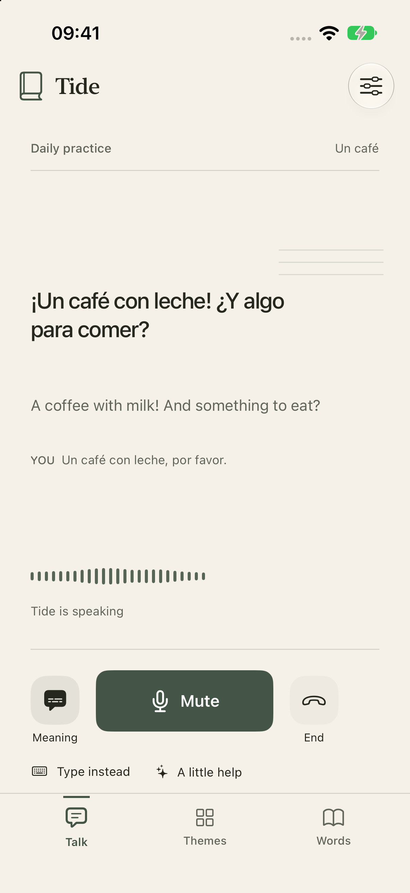
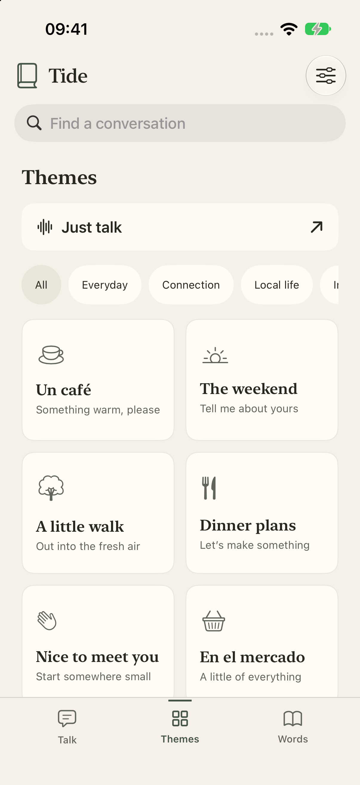
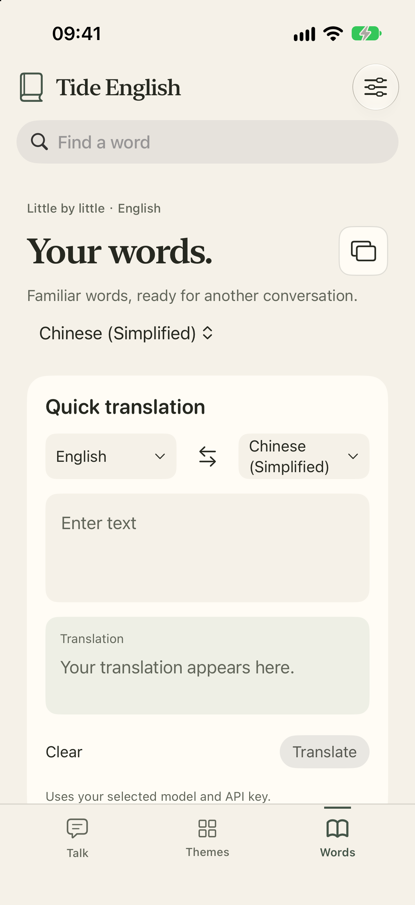
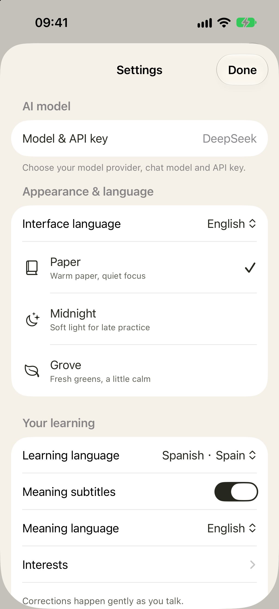

# Tide

<p align="center">
  <strong>Native multiplatform AI language-learning companion — master language through natural conversation.</strong>
</p>

<p align="center">
  <strong>English</strong> | <a href="README-CN.md">简体中文</a>
</p>

<p align="center">
  
  
  
  
</p>

---

Tide is a native language-learning application designed to help you practice spoken expression, listening comprehension, and vocabulary acquisition through natural, real-time AI conversations.

The repository includes a **SwiftUI** iOS client, a **Jetpack Compose** Android client, and an optional standalone email-code authentication backend.

### Key Architectural Principles

- 🔑 **Bring Your Own Key (BYOK)**: Connects directly to your preferred AI model provider (OpenAI, DeepSeek, Zhipu GLM, Google Gemini, or custom OpenAI-compatible endpoints) using your own API key, without third-party proxy lock-in.
- 🔒 **Local-First & Private**: Conversation history, vocabulary, and learning progress remain 100% inside your device sandbox.
- 🚀 **Zero Friction Out of the Box**: In-app account sign-in, hosted voice services, trials, and purchases are disabled by default. You can start learning immediately just by entering your model API key.
- 📦 **Clean Repository**: Contains the complete source code and pinned dependencies, free of private credentials, personal signing profiles, or historical build artifacts.

---

## Screenshots

<p align="center">
  <a href="docs/assets/screenshots/ios/en/talk.png"></a>
  <a href="docs/assets/screenshots/ios/en/themes.png"></a>
  <a href="docs/assets/screenshots/ios/en/vocabulary.png"></a>
  <a href="docs/assets/screenshots/ios/en/settings.png"></a>
</p>
<p align="center">
  <sub>Left to right: Bilingual conversation · Curated themes · Vocabulary &amp; quick translation · Model &amp; appearance settings (Paper theme)</sub><br />
  <sub>👉 See <a href="README-CN.md#应用截图">Chinese interface screenshots</a> · <a href="docs/assets/screenshots/README.md">Capture reproduction details</a></sub>
</p>

---

## Features

- 🎙️ **Real-Time Voice Conversations**
  - **Native Real-Time Audio**: Low-latency voice streaming using native WebRTC for OpenAI, and native WebSockets for GLM and Gemini.
  - **Intelligent Fallback**: For text-centric models (such as DeepSeek or custom LLMs), the app gracefully falls back to on-device speech recognition, LLM text generation, and system offline text-to-speech (TTS), with keyboard typing always available.
- ⚡ **Inline Quick Translation**
  - A compact search-and-translate bar pinned to the top of the vocabulary screen. Expands on tap to offer language pickers, swap, copy, and retry.
  - Automatically translates after a brief typing pause (up to 2,000 characters). Operates strictly as a reference tool without altering your vocabulary mastery ratings or review stats.
- 🤖 **Multi-Provider BYOK Integration**
  - A unified settings screen to configure OpenAI, DeepSeek, Zhipu GLM, Google Gemini, or any OpenAI-compatible custom endpoint.
  - API keys are encrypted and stored in secure local storage independently per provider. Changing an endpoint requires explicit renewed consent.
- 🎯 **Adaptive Bilingual Learning**
  - Learning and explanation languages are configured independently, supporting bilingual subtitles across 11 languages.
  - One-tap word lookup in context, automatic grammar corrections, personalized topic suggestions, and capability evidence tracking.
- 🎨 **Native Polish & Custom Themes**
  - Built purely with SwiftUI and Jetpack Compose for fluid animations and native responsiveness.
  - Includes **Paper**, **Midnight**, and **Grove** themes, with independent UI language settings (English or Chinese).
- 💾 **Local-First Data & Backups**
  - Complete control of your data: conversations, vocabulary cards, and review metrics can be exported and imported as JSON backups for easy migration between devices.

> [!NOTE]
> **Compatibility & Audio Requirements**:
> - Real-time audio models depend on provider platform capabilities and may differ from the selected chat text model.
> - Android device voice requires Android 12+ with available on-device speech recognition and an offline reading voice; otherwise, the app defaults to text input. Gemini realtime connections require reconnection after session expiry.
> - Testing on physical hardware is recommended for optimal microphone noise cancellation and Bluetooth audio routing.

---

## Project Structure

```text
tide/
├── mobile/
│   ├── ios/                 # iOS client: SwiftUI, Swift core package and Xcode project
│   │   ├── Application/     # Views, UI coordinators and native components
│   │   ├── Domain/          # Core teaching domain logic, model contracts and storage
│   │   ├── Configuration/   # Build settings and local configuration templates (Local.xcconfig)
│   │   └── TideEnglish.xcodeproj/
│   └── android/             # Android client: Jetpack Compose, Kotlin core and Gradle project
├── server/
│   ├── accounts/            # Standalone email-code authentication service (disabled by default)
│   └── gateway/             # Optional hosted gateway service (disabled by default)
├── packages/
│   ├── contracts/           # Cross-platform contract specifications
│   └── fixtures/            # Shared regression test fixtures
├── tools/                   # Project generators, content exporters, and consistency checks
├── distribution/            # Release templates and example catalog data
└── docs/                    # User, development, architecture, and operations documentation
```

---

## Run Locally

### 1. iOS Client

**Prerequisites**: Xcode with iOS 26.1 SDK support, and a Swift 6 toolchain.

From the repository root:

```sh
# 1. Generate and synchronize the Xcode project
python3 tools/generate_project.py

# 2. Open in Xcode
open mobile/ios/TideEnglish.xcodeproj
```

- Select the `TideEnglish` scheme in Xcode.
- Navigate to **Xcode → Settings → Accounts** to log into your Apple Account, then select your personal development team under **Signing & Capabilities** (enable automatic signing).
- The default bundle identifier is `cn.gd306.tideenglish.ios`. If unavailable, override `PRODUCT_BUNDLE_IDENTIFIER` in `mobile/ios/Configuration/Local.xcconfig` (copy from `Local.example.xcconfig`).
- Connect your iPhone, unlock it, enable Developer Mode when prompted, and hit Run. See the [iPhone guide](docs/guides/iphone.md).

---

### 2. Android Client

**Prerequisites**: JDK 17, Android SDK Platform 36, Build Tools 35.0.0, with `JAVA_HOME` and `ANDROID_HOME` configured.

From the repository root:

```sh
cd mobile/android
./gradlew :app:assembleDebug
```

- The compiled APK is generated at: `mobile/android/app/build/outputs/apk/debug/app-debug.apk`.
- Default Application ID: `cn.gd306.tideenglish.android` (minimum Android 8.0 / API 26).
- Install on device via adb: `adb -s <DEVICE_SERIAL> install -r app/build/outputs/apk/debug/app-debug.apk`. See the [Android guide](docs/guides/android.md).

---

### 3. Model & API Key Setup

1. Launch the app and select your learning and explanation languages.
2. Go to **Settings → Model & API key**, choose your provider (OpenAI / DeepSeek / GLM / Gemini / Custom), and enter your API key.
3. Start conversing or practicing words right away. See [Models and voice](docs/guides/models-and-voice.md).

> [!IMPORTANT]
> **Credential Security**: Never commit API keys to source control, logs, or chat transcripts. Keys are encrypted directly in device sandbox storage.

---

## Let an AI Agent Install the App on Your Phone

If you are using a coding assistant with access to your local files, terminal, and connected phone (such as Antigravity, Claude Code, or Cursor), you can copy the prompt below to automate toolchain verification, building, and device installation:

<details>
<summary>📋 <strong>Click to expand / copy the AI Agent prompt</strong></summary>

```text
Help me build, install and launch Tide on my iPhone or Android phone
from https://github.com/gd0306/tide.

Clone the repository into a new local folder, or use this checkout if already
open. Read AGENTS.md, README.md, docs/development/build-and-test.md and the
matching guide: docs/guides/iphone.md or docs/guides/android.md.

For iPhone, check Xcode and iOS tools, resolve pinned dependencies, run offline
Swift core tests and build the Simulator target. Guide me through Apple Account
and signing-team setup when needed. For Android, check JDK/SDK/adb and run the
Gradle unit tests, lint and debug build described in the guide.

For a first installation, help choose a unique application identifier if needed.
For updates, preserve the existing identifier, signing identity and Apple team.
Do not uninstall the app, clear learning data or bypass signing conflicts.

Detect my connected phone, build for that device, install and launch the app.
Tell me when to unlock it, trust the computer or developer profile, enable
Developer Mode or USB debugging, or approve a system prompt. Ask which device
only if the target is ambiguous.

I will select my languages and provider, then enter my key in Settings > Model
& API key. Never ask for the key in chat, read it from device secure storage,
or put it in source files or logs. Keep all in-app account sign-in (email,
Google and Apple), managed services, hosted trials and purchases disabled.
Do not configure account-service URLs, SMTP or OAuth unless I explicitly ask
for account functionality. App sign-in must not be required for learning or
translation. Apple Account sign-in in Xcode is only for building/signing.
Do not deploy servers or start a live conversation.

Report which tests, build, signing, installation and launch checks passed,
iOS signing expiry if available, and anything I still need to do on the phone.
I will start the first live conversation.
```

</details>

---

## Verification and Development

The project maintains strict cross-platform contract consistency and regression test suites. Run the offline verification commands from the root directory:

```sh
# 1. Run tools and data-flow unit tests
python3 -m unittest discover -s tools/tests -t .

# 2. Check exported multi-language content consistency
python3 tools/export_android_content.py --check

# 3. Check Swift/Kotlin cross-platform data contract alignment
python3 tools/check_cross_platform.py

# 4. Run native iOS Swift package tests
swift test --package-path mobile/ios
```

For complete instructions, see [Build and test](docs/development/build-and-test.md) and the [verification record](docs/development/verification.md). Changes to shared teaching logic must keep Swift, Kotlin, and contract checks aligned.

---

## Independent Identity and Learning Data

Tide was previously named Tide English. The public repository is now [`gd0306/tide`](https://github.com/gd0306/tide). Internal `TideEnglish` project/module names, `TIDE_ENGLISH_*` build settings, application IDs and existing storage paths remain stable so a brand update preserves installed apps and learning data.

- **Complete Sandbox Isolation**: Tide uses independent application identifiers (`cn.gd306.tideenglish.*`) and sandboxed storage. It operates independently and does not read or conflict with other app installations.
- **Data Migration**: To migrate learning records from a previous device or build, export a JSON backup from the original app and manually import it via Settings, then re-enter your API keys. Avoid uninstalling existing apps to resolve code signing mismatches to prevent accidental data loss.
- **Offline Autonomy**: Core learning capabilities (conversations, vocabulary, instant translation, and reviews) do not require hosted cloud services or user sign-in.

---

## Deployment and Production Notes

- **Example Domains & Catalog**: Release templates, sample products, and `.example` URLs in this repository serve as structural examples. They are not deployed publicly and do not indicate a live published app.
- **Self-Hosted Accounts (Optional)**: If you need optional email sign-in, you can deploy `server/accounts` and explicitly enable it via environment configuration. See the [account service guide](docs/operations/accounts.md). Account services are strictly decoupled from local learning records and do not sync learning data.

---

## License

This project is licensed under the [MIT License](LICENSE), retaining original copyright and third-party notices.
See [NOTICE](NOTICE) for provenance, [CONTRIBUTING.md](CONTRIBUTING.md) for contribution guidelines, and [SECURITY.md](SECURITY.md) for security vulnerability reporting.
