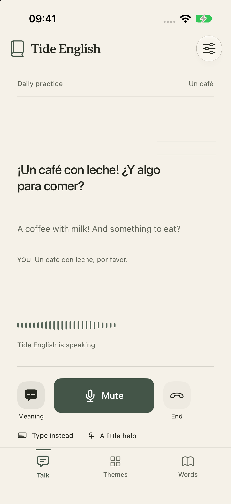
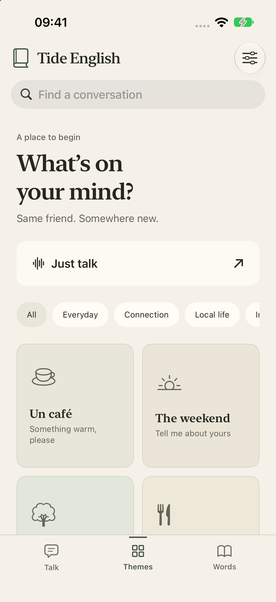
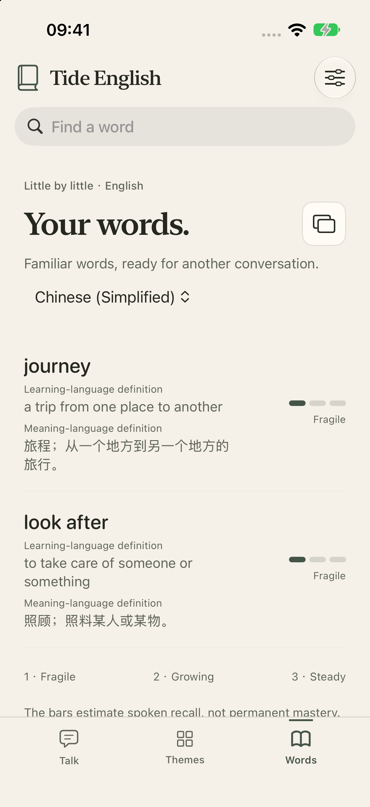
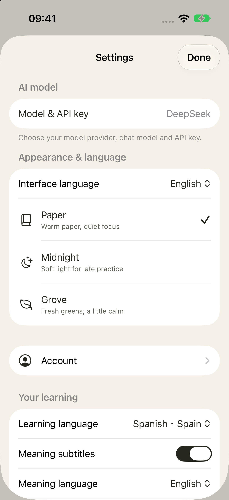

# Tide English

**English** | [简体中文](README-CN.md)

A native language-learning app for practising expression, comprehension and vocabulary through natural conversation. The project includes a SwiftUI iOS client, a Jetpack Compose Android client and a separate email account service.

Tide English uses your own model API key by default. Learning records stay on your device, and signing in is optional. Hosted voice, trials and purchases are disabled by default. This repository contains the full source and pinned dependencies, without user credentials, personal signing settings or historical build artifacts.

## Screenshots

<p align="center">
  <a href="docs/assets/screenshots/ios/en/talk.png"></a>
  <a href="docs/assets/screenshots/ios/en/themes.png"></a>
  <a href="docs/assets/screenshots/ios/en/vocabulary.png"></a>
  <a href="docs/assets/screenshots/ios/en/settings.png"></a>
</p>
<p align="center">Conversation · Themes · Bilingual vocabulary · Settings</p>

Captured from the current iOS app on an iPhone 17 simulator using offline sample data. English interface with the Paper theme; no real conversation, API key or personal learning record is shown. [Chinese interface](README-CN.md#应用截图) · [Capture details](docs/assets/screenshots/README.md).

## Features

| Feature | Description |
| --- | --- |
| Multiple providers | OpenAI, DeepSeek, GLM, Gemini and compatible custom endpoints; one settings screen for provider, model, endpoint and key |
| Voice conversations | Native realtime voice where supported; other models use device recognition, the selected model and system speech, with typing available when device voice is unsupported |
| Bilingual learning | Independent learning and explanation languages, bilingual captions, contextual word lookup, vocabulary definitions and review |
| Personalized teaching | Corrections, topics, learning goals and capability evidence, recorded separately for each language |
| Appearance | Paper, Midnight and Grove themes; Chinese or English interface, independent of the learning language |
| Local data | Conversations, vocabulary and learning progress, with manual backup and import |
| Optional accounts | Email-code sign-in, sign-out and account deletion; no learning-data cloud sync |

Realtime audio models depend on provider capabilities and may differ from the selected text model. Android device voice requires Android 12+ with available on-device recognition and an offline reading voice; otherwise, use typing. Gemini realtime connections require reconnection after expiry. Simulator tests do not establish physical microphone quality, Bluetooth behavior or model access for a particular account.

## Project structure

```text
tide-english/
├── mobile/
│   ├── ios/                 # SwiftUI, Swift core package, Xcode project and tests
│   │   ├── Application/
│   │   ├── Domain/
│   │   ├── Configuration/
│   │   └── TideEnglish.xcodeproj/
│   └── android/             # Compose, Kotlin core and Gradle project
├── server/
│   ├── accounts/            # Email-code authentication and account service
│   └── gateway/             # Optional hosted gateway, disabled by default
├── packages/
│   ├── contracts/           # Cross-platform contracts
│   └── fixtures/            # Shared regression fixtures
├── tools/                   # Project generation, content export and consistency checks
├── distribution/            # Release templates and example catalog data
└── docs/                    # User, development, architecture and operations guides
```

## Let an AI agent install the app on your phone

Open or attach this project directory in your agent, then send it the entire prompt below. It covers both iPhone and Android. The agent needs access to your local files, terminal and connected device. Complete Apple Account sign-in, system password entry, device trust and permission prompts yourself in the system UI; never send credentials or passwords in chat.

```text
Help me build, install and launch Tide English on my connected iPhone or
Android phone.

Use this checkout if it is already open, or clone the Tide English repository
URL I provide into a new local folder. If neither is accessible, ask for the
actual source location; do not invent a repository URL. Read AGENTS.md,
README.md or README-CN.md, docs/development/build-and-test.md, and the matching
platform guide: docs/guides/iphone.md or docs/guides/android.md. Preserve local
changes and use pinned dependencies without upgrading them.

Detect my connected physical phone and explicitly target that device. If
multiple phones make the target unclear, ask me to choose before installing.
Do not substitute a simulator or emulator for installation on my phone.

For iPhone, check that macOS, Xcode and its iOS tools are ready, resolve the
pinned packages, run the offline Swift core tests, and build the iOS Simulator
target. Use mobile/ios/TideEnglish.xcodeproj and the TideEnglish scheme.
Guide me through adding my Apple Account and choosing my signing team in
Xcode when needed. Preserve signing overrides in the ignored
mobile/ios/Configuration/Local.xcconfig before regenerating the project.
Build for my iPhone with the configured team, then install and launch it.

For Android, check JDK 17, Android SDK Platform 36, Build Tools 35.0.0 and adb.
Use the Gradle Wrapper in mobile/android to resolve dependencies and run
:app:testDebugUnitTest, :app:lintDebug and :app:assembleDebug. Check the APK's
identity and signing certificate, install with adb -s TARGET_SERIAL install -r,
and launch the app on that same phone.

For a first installation, help me choose a unique application identifier if
needed. When updating an existing installation, preserve its identifier and
signing identity, including the Apple team on iPhone. Do not uninstall, clear
learning data, force a downgrade or silently change identifiers to bypass a
conflict. Retain any same-name app with a different identifier as a separate
installation. If signing cannot be matched, preserve the app and explain why.

Proceed with the normal checks, builds and installation within your permission
rules. Tell me when I need to connect or unlock the phone, trust this computer
or developer profile, enable Developer Mode or USB debugging, select a team,
or approve a system prompt. I will enter passwords and verification codes in
the system UI; never ask me to send them in chat.

I will choose my learning, explanation and interface languages, then select a
provider and enter my own API key in Settings > Model & API key. Do not ask me
to paste the key into chat, read model keys or account tokens from device
storage, or put credentials in source files or logs. Keep managed/hosted
services, trials, purchases and learning cloud sync disabled. Email sign-in
must remain optional. Do not deploy servers, modify production data, send
verification emails or make live model requests during installation.

Finish by reporting the target phone, application identifier and version,
which test, build, signing, installation and launch checks passed, artifact
paths, iOS signing expiry if available, and anything I still need to do on the
phone. Report blockers accurately; a successful build alone is not a completed
installation. I will start the first live conversation.
```

## Run locally

### iOS

Prepare Xcode with support for the iOS 26.1 SDK. Pure Swift core tests require a Swift 6 toolchain. From the repository root:

```sh
python3 tools/generate_project.py
open mobile/ios/TideEnglish.xcodeproj
```

Add your Apple Account in Xcode and select your signing Team. The default bundle identifier is `cn.gd306.tideenglish.ios`; if unavailable, override it with your own unique identifier in the local signing configuration. See the [iPhone guide](docs/guides/iphone.md).

### Android

Prepare JDK 17, Android SDK Platform 36 and Build Tools 35.0.0, then set `JAVA_HOME` and `ANDROID_HOME`:

```sh
cd mobile/android
./gradlew :app:assembleDebug
```

The APK is written to `mobile/android/app/build/outputs/apk/debug/app-debug.apk`. The application ID is `cn.gd306.tideenglish.android`. See the [Android guide](docs/guides/android.md).

### Models and accounts

Choose your learning and explanation languages in the app, then enter your own key in **Settings → Model & API key**. Never put keys in source files, logs or chat. Credentials are stored separately for each provider and custom endpoint; changing the recipient requires renewed consent. See [Models and voice](docs/guides/models-and-voice.md).

Email identity is optional. Clients retain the email-account contract at `https://api.gd306.cn`; this project rebuild did not deploy or modify that live service. See the [account service guide](docs/operations/accounts.md) for self-hosting. Email identity and the hosted gateway are separate components.

## Verification and development

```sh
python3 -m unittest discover -s tools/tests -t .
python3 tools/export_android_content.py --check
python3 tools/check_cross_platform.py
swift test --package-path mobile/ios
```

See [Build and test](docs/development/build-and-test.md) for complete commands and the [verification record](docs/development/verification.md) for actual results and limitations. Changes to shared teaching logic must keep Swift, Kotlin and contract checks aligned.

## Independent identity and learning data

This project uses independent application identifiers and does not automatically read another installation's sandbox or credentials. The project rebuild did not uninstall apps, clear existing data or modify production databases. To migrate learning records, export a backup from the original app and manually import it into the new app; enter model keys again. Do not uninstall an existing app to resolve a signing mismatch.

Release templates, sample products and prices do not establish that this app is published or ready to accept payments. Before release, configure your own signing, store application and backend. Keep commercial features disabled until separately verified.

Website, support, privacy and terms links use reserved `.example` domains as release configuration examples and are not deployed. Replace them with pages you actually provide before public release. These example addresses are not used for model requests or the current email sign-in service.

## License

[MIT License](LICENSE), with original copyright and third-party attribution retained. See [NOTICE](NOTICE) for provenance, [CONTRIBUTING.md](CONTRIBUTING.md) for contribution guidelines and [SECURITY.md](SECURITY.md) for security handling.
